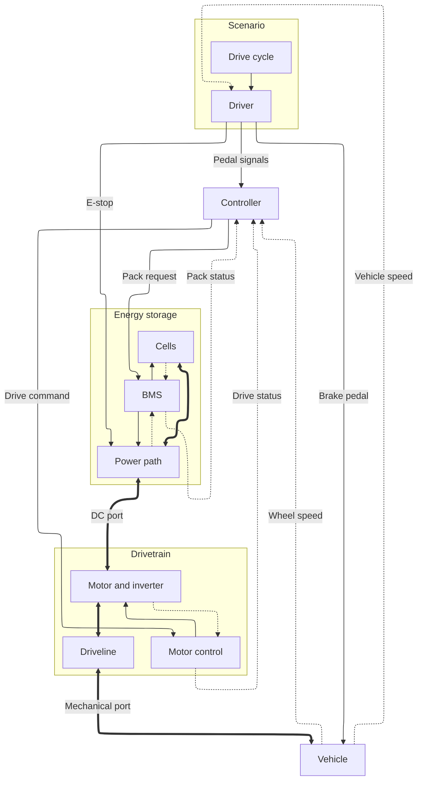
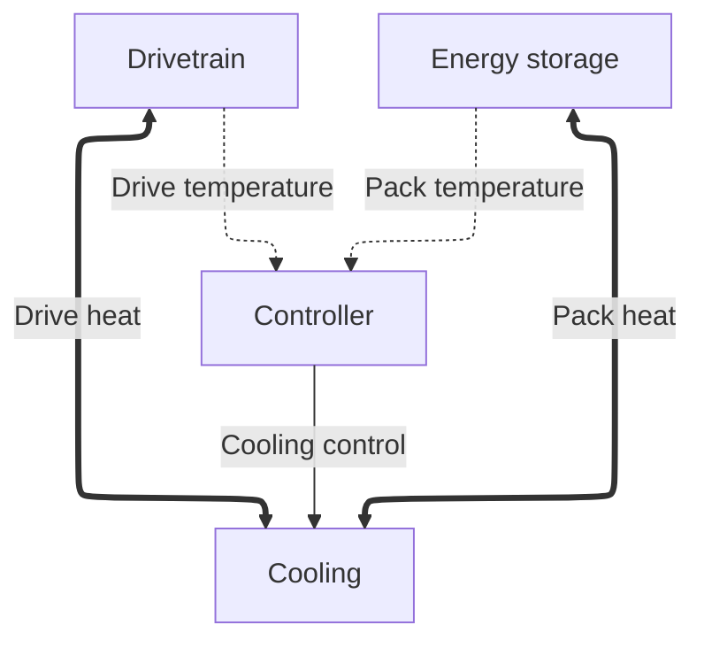

# Plant model framework

The plant is a set of [blocks](#blocks) joined by named buses and ports. The wiring is fixed: every edge exists at every level, at its neutral value where a level does not use it. Each block can be built at three [fidelity levels](#fidelity-and-modes), and a level changes only what happens inside a block. Build every block at Level 1 first, then raise one block at a time when a question needs it. The framework is [tool-neutral](#block-contract): Scilab Xcos or OpenModelica builds the blocks, and FMI joins the plant to embedded code ([DEC-014](../../docs/decisions/DEC-014-plant-model-in-xcos.md), proposed). Every parameter value is TBD unless research sets a first-pass value.

## Contents

- [Fidelity and modes](#fidelity-and-modes)
- [Structure](#structure)
- [Conventions](#conventions)
- [Blocks](#blocks)
- [Block contract](#block-contract)

## Fidelity and modes

Levels change block internals only. Each level extends the one below it.

| Level | Name | Question it answers | Mode | Solver |
| --- | --- | --- | --- | --- |
| 1 | Sizing | What power, voltage, gearing, and energy meet the goals? | Backward | None; SOC is a running sum |
| 2 | Performance | Does the kart reach its speed and acceleration, and what do losses, sag, and heat do? | Forward, with backward for sweeps | Variable step |
| 3 | Co-simulation | Does the embedded code behave correctly against the plant? | Forward | Fixed communication step at each controller's task rate |

Both modes share one parameter set and one set of loss equations.

- **Backward.** The speed trace drives demand through each block's `inverse`, on the Demand edges in the [bus table](#structure): Vehicle, Controller, Driveline, Motor and inverter, Power path, then Cells. Limits are not enforced. Each sample is checked against the published limits and the pack's power limit, and flagged if it exceeds one.
- **Forward.** The driver tracks the trace, the controller enforces the limits, and every state integrates. Forward is the reference mode, and co-simulation uses it only.
- Narrow a sweep in backward mode, then confirm the chosen point in forward mode. Energy per cycle must agree within a tolerance, which is TBD.

Rules:

- Level 1 must answer the REQ-SYS-004 sizing questions alone, so build it first.
- A Level 1 block with nothing to model is a pass-through. It copies input to output with zero loss and publishes neutral values.
- A higher level adds parameters and may replace equations. It never renames or removes a parameter, bus, bus signal, or port.
- Each block sets its level in `params/` as `level.<block>`. Levels may mix in a run if each block supports the run's mode.
- Every block keeps its lower levels selectable, so a result can be reproduced. Move up a level only when a question needs it.

The outputs each level must produce are in [Sizing outputs](README.md#sizing-outputs).

## Structure

Eleven blocks make up the plant. Scenario stands in for the driver and the test. Owners are subsystems from [SUBSYSTEMS.md](../../docs/architecture/SUBSYSTEMS.md).

| Block | Group | Owner | Purpose | At Level 3 |
| --- | --- | --- | --- | --- |
| [Drive cycle](#drive-cycle-and-driver) | Scenario | System | Speed trace for each scenario | Plant |
| [Driver](#drive-cycle-and-driver) | Scenario | System | Turns speed error into pedal, brake, and E-stop | Plant |
| [Controller](#controller) | None | VCU | Turns pedal into a torque command within the limits | Embedded code |
| [Cells](#cells) | Energy storage | PACK | Pack voltage, SOC, and cell losses | Plant |
| [BMS](#bms) | Energy storage | PACK | Current limits, contactor authority, and pack status | Embedded code |
| [Power path](#power-path) | Energy storage | PACK | Conduction from the cells to the DC port | Plant |
| [Motor control](#motor-control) | Drivetrain | DRV | Turns the torque command into motor drive | Embedded code |
| [Motor and inverter](#motor-and-inverter) | Drivetrain | DRV | Converts DC power to shaft power | Plant |
| [Driveline](#driveline) | Drivetrain | DRV | Gear ratio from the shaft to the wheel | Plant |
| [Vehicle](#vehicle) | None | CHS | Longitudinal force balance | Plant |
| [Cooling](#cooling) | None | TMS | Carries block heat to ambient, with optional active cooling on the Controller's command; from Level 2 | Plant |

The Cooling block joins the Controller and both groups from Level 2 onwards:

Thick lines carry power/energy, solid lines carry commands, and dotted lines carry feedback. A double arrow is a power port. Edges inside a group are named in the IO tables of its blocks.

- The brakes are mechanical, so Brake pedal reaches the Vehicle directly, not through the Controller.
- E-stop reaches the Power path directly, so the safe state needs no software ([SUBSYSTEMS.md](../../docs/architecture/SUBSYSTEMS.md#architecture)).

| Bus | Type | Defined in |
| --- | --- | --- |
| Pedal signals | Command | [Drive cycle and driver](#drive-cycle-and-driver) |
| Brake pedal | Command | [Drive cycle and driver](#drive-cycle-and-driver) |
| E-stop | Command | [Drive cycle and driver](#drive-cycle-and-driver) |
| Pack request | Command | [Controller](#controller) |
| Drive command | Command | [Controller](#controller) |
| Cooling control | Command | [Controller](#controller) |
| Pack status | Feedback | [BMS](#bms) |
| Drive status | Feedback | [Motor control](#motor-control) |
| Wheel speed | Feedback | [Vehicle](#vehicle) |
| Vehicle speed | Feedback | [Vehicle](#vehicle) |
| Pack temperature | Feedback | [Cells](#cells), [Power path](#power-path) |
| Drive temperature | Feedback | [Motor and inverter](#motor-and-inverter), [Driveline](#driveline) |
| DC port | Power port | [Power path](#power-path), [Motor and inverter](#motor-and-inverter) |
| Mechanical port | Power port | [Driveline](#driveline), [Vehicle](#vehicle) |
| Pack heat | Power port | [Cells](#cells), [Power path](#power-path), [Cooling](#cooling) |
| Drive heat | Power port | [Motor and inverter](#motor-and-inverter), [Driveline](#driveline), [Cooling](#cooling) |
| Trace | Demand | [Drive cycle and driver](#drive-cycle-and-driver) |
| Required force | Demand | [Vehicle](#vehicle) |
| Wheel torque demand | Demand | [Controller](#controller) |
| Shaft demand | Demand | [Driveline](#driveline) |
| DC power demand | Demand | [Motor and inverter](#motor-and-inverter) |
| Pack power demand | Demand | [Power path](#power-path) |

## Conventions

Signs:

- Power, torque, and current are positive in the motoring direction, from cells to road.
- Regen makes $T_m$, $P_{dc}$, and $I_{pack}$ negative. Losses stay positive, so regen returns less than the wheel gives up.
- A block's $P_{loss}$ is the power entering it minus the power leaving it, which is positive in both directions.
- Vehicle speed $v$ is zero or positive. The model does not drive in reverse.
- Auxiliary loads, such as the VCU and telemetry, draw from the DC bus inside the Power path as $P_{aux}$.

Symbol tables:

- The Parameter column is the name used in `params/` files.
- The Level column is the lowest level that uses the symbol.
- For a bus signal, the Value column gives its neutral value. "True value" means the block passes the computed value unchanged.
- Each symbol is defined in one table. A block that uses another block's symbol lists it in its IO table.

Thermal nodes: from Level 2, each block with a loss has one lumped temperature node. These are the Cells, Power path, Motor and inverter, and Driveline. Each node is cooled through its heat port to [Cooling](#cooling). At Level 1 there are no nodes, and every temperature is $T_{amb}$.

$$C_{th} \frac{dT}{dt} = P_{loss} - Q_{cool}$$

Global parameters and shared symbols, read by any block:

| Symbol | Parameter | Meaning | Unit | Value | Level |
| --- | --- | --- | --- | --- | --- |
| $g$ | `g` | Gravitational acceleration | m/s² | [Parameter map](../../research/Vehicle%20Dynamics/vehicle-dynamics-constants.md#parameter-map) | 1 |
| $\rho$ | `rho` | Air density | kg/m³ | [Parameter map](../../research/Vehicle%20Dynamics/vehicle-dynamics-constants.md#parameter-map) | 1 |
| $T_{amb}$ | `T_amb` | Ambient temperature | K | TBD | 1 |
| $P_{loss}$ | | Power loss of one block, which heats its thermal node | W | Always computed | 1 |
| $T$ | | Block temperature, a state, published on Pack temperature or Drive temperature | K | $T_{amb}$ | 1 |
| $C_{th}$ | `C_th.<block>` | Thermal capacity of one block | J/K | TBD | 2 |

## Blocks

Each block lists its IO, its equations by level, and its symbols. In the IO tables, Port rows give the effort and flow directions, which hold at every level.

### Drive cycle and driver

| Bus | I/O | Peer | Signals |
| --- | --- | --- | --- |
| Reference speed | Internal | Drive cycle to Driver | $v_{ref}$, from Level 2 |
| Trace | Out | [Vehicle](#vehicle) | $v_{ref}$ and its derivative, backward mode |
| Pedal signals | Out | [Controller](#controller) | $a$, $b$ |
| Brake pedal | Out | [Vehicle](#vehicle) | $b$ |
| E-stop | Out | [Power path](#power-path) | $s_{estop}$ |
| Vehicle speed | In | [Vehicle](#vehicle) | $v$ |

**Level 1.** The drive cycle gives a speed trace $v_{ref}(t)$ and its derivative. There is no driver, because backward mode follows the trace exactly.

**Level 2.** A PI driver turns speed error into pedal or brake (Adegbohun 2021, Thapa 2024). PI is a placeholder until a pending DEC chooses the driver algorithm.

$$e = v_{ref} - v$$

$$u = K_p \, e + K_i \int_0^t e \, d\tau$$

$$a = \min\left(\max(u, 0), 1\right), \qquad b = \min\left(\max(-u, 0), 1\right)$$

**Level 3.** Scripted fault events act on the pedals, and can press the E-stop. Level 3 is also where the Driver gains any other IO that the embedded code needs. Examples are buttons or switches for controller features, and a charging interface to the BMS. Each is declared here as a bus, with neutral values, before any level uses it.

| Symbol | Parameter | Meaning | Unit | Value | Level |
| --- | --- | --- | --- | --- | --- |
| $v_{ref}$ | | Reference speed from the drive cycle | m/s | Per scenario, [DEC-011](../../docs/decisions/DEC-011-useful-session-definition.md) | 1 |
| $e$ | | Speed error | m/s | Computed | 2 |
| $u$ | | Driver command, positive to accelerate | 1 | Computed | 2 |
| $K_p$ | `K_p` | Proportional gain | s/m | TBD | 2 |
| $K_i$ | `K_i` | Integral gain | 1/m | TBD | 2 |
| $a$ | | Accelerator pedal position | 0 to 1 | 0 at Level 1 | 2 |
| $b$ | | Brake pedal position | 0 to 1 | 0 at Level 1 | 2 |
| $s_{estop}$ | | E-stop pressed | 0 or 1 | 0 | 1 |

### Controller

| Bus | I/O | Peer | Signals |
| --- | --- | --- | --- |
| Pedal signals | In | [Driver](#drive-cycle-and-driver) | $a$, $b$ |
| Pack status | In | [BMS](#bms) | $s_c$, $V_{pack}$, $\hat{I}_{pack}$, $SOC$, $I_{dcl}$, $I_{ccl}$, $f_{pack}$ |
| Drive status | In | [Motor control](#motor-control) | $\omega_m$, $T_{max}$, $T_{min}$, $f_{drive}$ |
| Wheel speed | In | [Vehicle](#vehicle) | $\omega_w$ |
| Required force | In | [Vehicle](#vehicle) | $F_{req}$, $\omega_w$, backward mode |
| Wheel torque demand | Out | [Driveline](#driveline) | $T_w$, $\omega_w$, backward mode |
| Pack temperature | In | [Cells](#cells), [Power path](#power-path) | $T$ |
| Drive temperature | In | [Motor and inverter](#motor-and-inverter), [Driveline](#driveline) | $T$ |
| Pack request | Out | [BMS](#bms) | $s_{ready}$ |
| Drive command | Out | [Motor control](#motor-control) | $T_{cmd}$, $s_{en}$ |
| Cooling control | Out | [Cooling](#cooling) | $u_{cool}$ |
| Parameters | In | [Motor and inverter](#motor-and-inverter), [Vehicle](#vehicle) | $\eta_m$, $r_w$ |

**Level 1.** Backward mode has no pedals. The Controller turns the required traction force $F_{req}$ from the [Vehicle](#vehicle) into a wheel torque demand for the [Driveline](#driveline). $F_{req}$ is positive when motoring and negative when braking.

1. Split the braking demand. A fixed share goes to regen, and the friction brake takes the rest. When motoring, the demand is 0.

$$F_{dem} = \max(-F_{req}, 0)$$

$$F_{regen} = \phi_{regen} \, F_{dem}, \qquad F_{brake} = F_{dem} - F_{regen}$$

2. Find the wheel force and torque. The wheel supplies the traction force plus whatever the friction brake removes.

$$F_{wheel} = F_{req} + F_{brake}, \qquad T_w = r_w \, F_{wheel}$$

- When motoring, $F_{brake} = 0$, so $F_{wheel} = F_{req}$. This is where motoring energy enters the sizing chain.
- When braking, $F_{wheel} = -F_{regen}$, so $T_w$ is negative and the wheel drives regen.
- The limits on Pack status and Drive status carry their neutral values. A limit that is TBD is not checked.

**Level 2.** The Controller turns pedal into a torque command within the limits. The pack current limits become torque limits through the nominal motor efficiency.

$$T_{hi} = \min\left(T_{max}, \; \frac{\eta_m V_{pack} I_{dcl}}{\omega_m}\right), \qquad T_{lo} = \max\left(T_{min}, \; -\frac{V_{pack} I_{ccl}}{\eta_m \, \omega_m}\right)$$

$$T_{req} = \begin{cases} a \, T_{hi} & a > 0 \\ b \, T_{lo} & a = 0, \; v > v_{regen} \\ 0 & \text{otherwise} \end{cases}$$

$$T_{cmd} = \min\left(\max(T_{req}, T_{lo}), T_{hi}\right)$$

- At standstill the current-limit terms are unbounded, so $T_{max}$ and $T_{min}$ govern.
- The friction brake is mechanical, in the Vehicle. Regen adds to it rather than blending with it.
- Regen on the brake pedal is a placeholder. The VCU cycle sets the real regen strategy.
- $u_{cool}$ holds its neutral value, passive cooling only, until a cooling strategy exists.
- $v$ comes from Wheel speed, as $\omega_w r_w$.

**Level 3.** Compiled VCU code replaces this block.

| Symbol | Parameter | Meaning | Unit | Value | Level |
| --- | --- | --- | --- | --- | --- |
| $\phi_{regen}$ | `phi_regen` | Share of braking demand taken by regen, backward mode only | 0 to 1 | TBD, sweep 0 to 1 | 1 |
| $F_{dem}$ | | Total braking force demanded | N | Computed | 1 |
| $F_{regen}$ | | Braking force taken by regen | N | Computed | 1 |
| $T_{cmd}$ | | Torque command | N·m | Always computed | 1 |
| $s_{en}$ | | Drive enable | 0 or 1 | 1 | 1 |
| $s_{ready}$ | | Drive-ready request | 0 or 1 | 1 | 1 |
| $u_{cool}$ | | Cooling command, 0 for passive and 1 for active cooling | 0 to 1 | 0 | 1 |
| $T_{hi}$, $T_{lo}$ | | Upper and lower torque bounds from all limits | N·m | Computed | 2 |
| $T_{req}$ | | Torque request before clipping | N·m | Computed | 2 |
| $v_{regen}$ | `v_regen` | Speed below which regen is off | m/s | TBD | 2 |

### Cells

Cells scale to the pack by series and parallel count.

| Bus | I/O | Peer | Signals |
| --- | --- | --- | --- |
| Cell power | Port | [Power path](#power-path) | $V_{pack}$ out, $I_{pack}$ in |
| Cell sense | Out | [BMS](#bms) | $V_{pack}$, $SOC$; $T$ from Level 2; $V_{grp}$ at Level 3 |
| Balancing command | In | [BMS](#bms) | $s_{bal}$, Level 3 |
| Pack heat | Port | [Cooling](#cooling) | $T$ out, $Q_{cool}$ in |
| Pack temperature | Out | [Controller](#controller) | $T$ |
| Pack power demand | In | [Power path](#power-path) | $P_{pack}$, backward mode |

**Level 1.** Open-circuit voltage and series resistance only. The open-circuit voltage may be held constant.

$$I_{cell} = I_{pack} / n_p$$

$$V_{pack} = n_s \left( \mathrm{OCV}(SOC) - R_0 I_{cell} \right)$$

$$\frac{d \, SOC}{dt} = -\frac{I_{cell}}{Q}$$

Backward mode knows the power and solves for current (Adegbohun 2021):

$$I_{pack} = \frac{V_{oc} - \sqrt{V_{oc}^2 - 4 R_{pack} P_{pack}}}{2 R_{pack}}, \qquad V_{oc} = n_s \, \mathrm{OCV}(SOC), \qquad R_{pack} = \frac{n_s R_0}{n_p}$$

A negative discriminant means the pack cannot deliver that power. Backward mode flags the sample.

**Level 2.** An RC pair adds voltage sag under load steps.

$$V_{pack} = n_s \left( \mathrm{OCV}(SOC) - R_0 I_{cell} - V_{rc} \right)$$

$$\frac{dV_{rc}}{dt} = \frac{I_{cell}}{C_1} - \frac{V_{rc}}{R_1 C_1}$$

Backward mode then uses $n_s \left( \mathrm{OCV}(SOC) - V_{rc} \right)$ as $V_{oc}$.

**Level 3.** Cells group into series strings with spread in capacity and resistance. Each group reports its own voltage to the BMS, for balancing and cell-level fault tests.

| Symbol | Parameter | Meaning | Unit | Value | Level |
| --- | --- | --- | --- | --- | --- |
| $n_s$, $n_p$ | `n_s`, `n_p` | Cells in series and in parallel | 1 | Sizing output | 1 |
| $\mathrm{OCV}(SOC)$ | `OCV_table` | Cell open-circuit voltage curve | V | TBD, cell choice | 1 |
| $R_0$ | `R_0` | Cell series resistance | Ω | TBD, cell choice | 1 |
| $Q$ | `Q_cell` | Cell capacity | A·s | TBD, cell choice | 1 |
| $SOC$ | | State of charge, a state | 0 to 1 | True value | 1 |
| $I_{pack}$, $I_{cell}$ | | Pack and cell current | A | Computed | 1 |
| $V_{pack}$ | | Pack terminal voltage | V | True value | 1 |
| $P_{pack}$ | | Pack terminal power | W | Computed | 1 |
| $V_{oc}$, $R_{pack}$ | | Pack open-circuit voltage and resistance, backward mode | V, Ω | Computed | 1 |
| $R_1$, $C_1$ | `R_1`, `C_1` | Cell RC pair | Ω, F | TBD, cell choice | 2 |
| $V_{rc}$ | | RC branch voltage, a state | V | Computed | 2 |
| $V_{grp}$ | | Voltage of one cell group | V | $V_{pack}$ shared evenly | 3 |

### BMS

The BMS publishes Pack status and has authority over the contactors.

| Bus | I/O | Peer | Signals |
| --- | --- | --- | --- |
| Cell sense | In | [Cells](#cells) | $V_{pack}$, $SOC$; $T$ from Level 2; $V_{grp}$ at Level 3 |
| Path sense | In | [Power path](#power-path) | $\hat{I}_{pack}$, $s_c$ |
| Pack request | In | [Controller](#controller) | $s_{ready}$ |
| Pack status | Out | [Controller](#controller) | $s_c$, $V_{pack}$, $\hat{I}_{pack}$, $SOC$, $I_{dcl}$, $I_{ccl}$, $f_{pack}$ |
| Contactor command | Out | [Power path](#power-path) | $s_{close}$, $s_{pre}$, Level 3 |
| Balancing command | Out | [Cells](#cells) | $s_{bal}$, Level 3 |

**Level 1.** A pass-through. It publishes constant current limits, reports the contactors closed, and passes true values as measurements.

$$I_{dcl} = I_{dcl,0}, \qquad I_{ccl} = I_{ccl,0}$$

**Level 2.** The limits drop to zero at the cell voltage floor and ceiling. This ends a run-time test cleanly.

$$V_{cell} = V_{pack} / n_s$$

$$I_{dcl} = \begin{cases} I_{dcl,0} & V_{cell} > V_{min} \\ 0 & V_{cell} \le V_{min} \end{cases}, \qquad I_{ccl} = \begin{cases} I_{ccl,0} & V_{cell} < V_{max} \\ 0 & V_{cell} \ge V_{max} \end{cases}$$

**Level 3.** Compiled BMS code replaces this block.

| Symbol | Parameter | Meaning | Unit | Value | Level |
| --- | --- | --- | --- | --- | --- |
| $I_{dcl}$, $I_{ccl}$ | | Published discharge and charge current limits | A | $I_{dcl,0}$, $I_{ccl,0}$ | 1 |
| $I_{dcl,0}$ | `I_dcl_0` | Discharge current limit | A | TBD, pack choice | 1 |
| $I_{ccl,0}$ | `I_ccl_0` | Charge current limit, for regen | A | TBD, pack choice | 1 |
| $f_{pack}$ | | Pack fault | 0 or 1 | 0 | 1 |
| $s_{close}$ | | Contactor close command | 0 or 1 | 1 | 3 |
| $s_{pre}$ | | Precharge command | 0 or 1 | 0 | 3 |
| $s_{bal}$ | | Balancing command, per cell group | 0 or 1 | 0 | 3 |
| $V_{cell}$ | | Mean cell voltage | V | Computed | 2 |
| $V_{min}$ | `V_cell_min` | Cell voltage floor | V | TBD, cell choice | 2 |
| $V_{max}$ | `V_cell_max` | Cell voltage ceiling | V | TBD, cell choice | 2 |

### Power path

The conduction path from the cells to the DC port: fuse, contactors, precharge, shunt, and the auxiliary load tap.

| Bus | I/O | Peer | Signals |
| --- | --- | --- | --- |
| Cell power | Port | [Cells](#cells) | $V_{pack}$ in, $I_{pack}$ out |
| DC port | Port | [Motor and inverter](#motor-and-inverter) | $V_{bus}$ out, $I_{dc}$ in |
| E-stop | In | [Driver](#drive-cycle-and-driver) | $s_{estop}$ |
| Contactor command | In | [BMS](#bms) | $s_{close}$, $s_{pre}$, Level 3 |
| Path sense | Out | [BMS](#bms) | $\hat{I}_{pack}$, $s_c$ |
| Pack heat | Port | [Cooling](#cooling) | $T$ out, $Q_{cool}$ in |
| Pack temperature | Out | [Controller](#controller) | $T$ |
| Parameters | In | [Motor and inverter](#motor-and-inverter) | $C_{link}$ |
| DC power demand | In | [Motor and inverter](#motor-and-inverter) | $P_{dc}$, backward mode |
| Pack power demand | Out | [Cells](#cells) | $P_{pack}$, backward mode |

**Level 1.** A pass-through, plus a constant auxiliary load.

$$V_{bus} = V_{pack}, \qquad P_{pack} = V_{bus} I_{dc} + P_{aux}$$

**Level 2.** Lumped resistance for wire, fuse, contactors, and shunt.

$$V_{bus} = V_{pack} - R_{path} I_{pack}$$

Backward mode adds $R_{path}$ to $R_{pack}$ in the [Cells](#cells) current equation.

**Level 3.** The block adds precharge, the fuse, contactor states, and a measured pack current.

$$\frac{dV_{link}}{dt} = \frac{V_{pack} - V_{link}}{R_{pre} \, C_{link}}$$

$$\text{fuse trips when} \int I_{pack}^2 \, dt \ge \left( I^2 t \right)_{fuse}$$

$$\hat{I}_{pack} = (1 + g_I) \, I_{pack} + o_I + n_I(t)$$

- Contactors and the E-stop loop are discrete states, opened by events. The E-stop opens the loop without the BMS or the Controller.
- The DC-link capacitor sits physically in the inverter. It is modeled here so the DC port keeps its causality.

| Symbol | Parameter | Meaning | Unit | Value | Level |
| --- | --- | --- | --- | --- | --- |
| $V_{bus}$ | | DC bus voltage at the DC port | V | Computed | 1 |
| $P_{aux}$ | `P_aux` | Auxiliary electronics load | W | TBD, default 0 | 1 |
| $s_c$ | | Contactor state, 1 when closed | 0 or 1 | 1 | 1 |
| $\hat{I}_{pack}$ | | Measured pack current | A | True value | 1 |
| $R_{path}$ | `R_path` | Wire, fuse, contactor, and shunt resistance | Ω | TBD | 2 |
| $V_{link}$ | | DC-link capacitor voltage, a state | V | Computed | 3 |
| $R_{pre}$ | `R_pre` | Precharge resistance | Ω | TBD | 3 |
| $(I^2t)_{fuse}$ | `I2t_fuse` | Fuse let-through rating | A²·s | TBD | 3 |
| $g_I$, $o_I$, $n_I$ | `g_I`, `o_I`, `n_I` | Shunt gain error, offset, and noise | 1, A, A | TBD, default 0 | 3 |

### Motor control

| Bus | I/O | Peer | Signals |
| --- | --- | --- | --- |
| Drive command | In | [Controller](#controller) | $T_{cmd}$, $s_{en}$ |
| Motor sense | In | [Motor and inverter](#motor-and-inverter) | $\omega_m$; at Level 3 also $V_{bus}$, $i_{ph}$ or $i_a$, and $\theta_m$ |
| Motor command | Out | [Motor and inverter](#motor-and-inverter) | $T_m$ at Levels 1 and 2; duty or phase voltage at Level 3 |
| Drive status | Out | [Controller](#controller) | $\omega_m$, $T_{max}$, $T_{min}$, $f_{drive}$ |

**Levels 1 and 2.** A pass-through. Shaft torque equals the command, and the envelope comes from parameters.

$$T_m = T_{cmd}$$

**Level 3.** Compiled motor control code replaces this block.

| Symbol | Parameter | Meaning | Unit | Value | Level |
| --- | --- | --- | --- | --- | --- |
| $T_{max}$ | `T_max` | Motoring torque envelope, a function of shaft speed and bus voltage | N·m | TBD, motor choice. Published as is. | 1 |
| $T_{min}$ | `T_min` | Regen torque envelope, zero or negative | N·m | TBD, motor choice. Published as is. | 1 |
| $f_{drive}$ | | Drive fault | 0 or 1 | 0 | 1 |
| $d$ | | Chopper duty cycle, on Motor command | 0 to 1 | Computed | 3 |
| $v_d$, $v_q$ | | dq phase voltages, on Motor command | V | Computed | 3 |

### Motor and inverter

The motor and inverter are lumped at Levels 1 and 2.

| Bus | I/O | Peer | Signals |
| --- | --- | --- | --- |
| Motor command | In | [Motor control](#motor-control) | $T_m$ at Levels 1 and 2; duty or phase voltage at Level 3 |
| Motor sense | Out | [Motor control](#motor-control) | $\omega_m$; at Level 3 also $V_{bus}$, $i_{ph}$ or $i_a$, and $\theta_m$ |
| DC port | Port | [Power path](#power-path) | $V_{bus}$ in, $I_{dc}$ out |
| Shaft | Port | [Driveline](#driveline) | $T_m$ out, $\omega_m$ in |
| Drive heat | Port | [Cooling](#cooling) | $T$ out, $Q_{cool}$ in |
| Drive temperature | Out | [Controller](#controller) | $T$ |
| Parameters | Out | [Controller](#controller), [Power path](#power-path), [Vehicle](#vehicle) | $\eta_m$, $C_{link}$, $J_{rotor}$ |
| Shaft demand | In | [Driveline](#driveline) | $T_m$, $\omega_m$, backward mode |
| DC power demand | Out | [Power path](#power-path) | $P_{dc}$, backward mode |

**Level 1.** A constant efficiency, which gives losses in both motoring and regen.

$$P_{mech} = T_m \, \omega_m$$

$$P_{dc} = \begin{cases} P_{mech} / \eta_m & T_m \ge 0 \\ P_{mech} \, \eta_m & T_m < 0 \end{cases}, \qquad I_{dc} = P_{dc} / V_{bus}$$

**Level 2.** A loss model replaces the constant efficiency (Adegbohun 2021). A datasheet efficiency map $\eta_m(T_m, \omega_m)$ may replace it in the Level 1 equation instead.

$$P_{loss} = k_c T_m^2 + k_i \, \omega_m + k_w \, \omega_m^3 + C$$

$$P_{dc} = P_{mech} + P_{loss}$$

**Level 3.** Motor control drives the motor, so torque follows from current. A brushed DC motor with a chopper uses the armature model:

$$d \, V_{bus} = R_a i_a + L_a \frac{di_a}{dt} + k_e \, \omega_m, \qquad T_m = k_t \, i_a, \qquad I_{dc} = d \, i_a$$

A permanent-magnet AC motor uses the averaged dq-axis model, with $\omega_e = p \, \omega_m$:

$$v_d = R i_d + L_d \frac{di_d}{dt} - \omega_e L_q i_q$$

$$v_q = R i_q + L_q \frac{di_q}{dt} + \omega_e \left( L_d i_d + \lambda \right)$$

$$T_m = \tfrac{3}{2} p \left( \lambda i_q + (L_d - L_q) i_d i_q \right)$$

| Symbol | Parameter | Meaning | Unit | Value | Level |
| --- | --- | --- | --- | --- | --- |
| $T_m$ | | Shaft torque, negative in regen | N·m | Computed | 1 |
| $\omega_m$ | | Shaft speed | rad/s | True value | 1 |
| $P_{mech}$ | | Shaft power | W | Computed | 1 |
| $P_{dc}$ | | DC input power | W | Computed | 1 |
| $I_{dc}$ | | DC input current | A | Computed | 1 |
| $\eta_m$ | `eta_m` | Motor and inverter efficiency, constant or a map | 1 | TBD | 1 |
| $J_{rotor}$ | `J_rotor` | Rotor and motor-side sprocket inertia | kg·m² | TBD | 1 |
| $k_c$ | `k_c` | Copper loss coefficient | W/(N·m)² | TBD | 2 |
| $k_i$ | `k_i` | Iron loss coefficient | W·s/rad | TBD | 2 |
| $k_w$ | `k_w` | Windage loss coefficient | W·s³/rad³ | TBD | 2 |
| $C$ | `C_loss` | Constant loss | W | TBD | 2 |
| $R_a$, $L_a$ | `R_a`, `L_a` | Armature resistance and inductance | Ω, H | TBD | 3 |
| $k_e$, $k_t$ | `k_e`, `k_t` | Back-EMF and torque constants | V·s/rad, N·m/A | TBD | 3 |
| $i_a$ | | Armature current, for the brushed DC motor | A | Computed | 3 |
| $i_{ph}$ | | Measured phase current, for the AC motor | A | 0 | 3 |
| $\theta_m$ | | Rotor position | rad | 0 | 3 |
| $R$, $L_d$, $L_q$ | `R_s`, `L_d`, `L_q` | Stator resistance and dq inductances | Ω, H | TBD | 3 |
| $\lambda$ | `lambda_pm` | Permanent-magnet flux linkage | Wb | TBD | 3 |
| $p$ | `p` | Pole pairs | 1 | TBD | 3 |
| $\omega_e$ | | Electrical speed | rad/s | Computed | 3 |
| $i_d$, $i_q$ | | dq currents | A | Computed | 3 |
| $C_{link}$ | `C_link` | DC-link capacitance | F | TBD | 3 |

### Driveline

The driveline ends at the Mechanical port, as wheel torque and wheel speed.

| Bus | I/O | Peer | Signals |
| --- | --- | --- | --- |
| Shaft | Port | [Motor and inverter](#motor-and-inverter) | $T_m$ in, $\omega_m$ out |
| Mechanical port | Port | [Vehicle](#vehicle) | $\omega_w$ in, $T_w$ out |
| Wheel torque demand | In | [Controller](#controller) | $T_w$, $\omega_w$, backward mode |
| Shaft demand | Out | [Motor and inverter](#motor-and-inverter) | $T_m$, $\omega_m$, backward mode |
| Drive heat | Port | [Cooling](#cooling) | $T$ out, $Q_{cool}$ in |
| Drive temperature | Out | [Controller](#controller) | $T$ |
| Parameters | Out | [Vehicle](#vehicle) | $N$ |

**Levels 1 and 2.** A fixed ratio with one efficiency. The efficiency multiplies while motoring and divides during regen.

$$\omega_m = N \, \omega_w$$

$$T_w = \begin{cases} N \, \eta_d \, T_m & T_m \ge 0 \\ N \, T_m / \eta_d & T_m < 0 \end{cases}$$

**Level 3.** Backlash and shaft compliance add states between the motor and the wheel. The Drivetrain then carries the rotor inertia itself, so drop $N^2 J_{rotor}$ from $k_m$ in the [Vehicle](#vehicle), or it counts twice.

| Symbol | Parameter | Meaning | Unit | Value | Level |
| --- | --- | --- | --- | --- | --- |
| $N$ | `N` | Gear ratio, motor to wheel | 1 | Sizing output | 1 |
| $\eta_d$ | `eta_d` | Chain or belt efficiency | 1 | TBD | 1 |
| $T_w$ | | Wheel torque | N·m | Computed | 1 |

### Vehicle

A longitudinal force balance. The rotating-mass factor scales mass in the acceleration term only (Thapa 2024, Adegbohun 2021).

| Bus | I/O | Peer | Signals |
| --- | --- | --- | --- |
| Mechanical port | Port | [Driveline](#driveline) | $\omega_w$ out, $T_w$ in |
| Brake pedal | In | [Driver](#drive-cycle-and-driver) | $b$ |
| Trace | In | [Drive cycle](#drive-cycle-and-driver) | $v_{ref}$ and its derivative, backward mode |
| Required force | Out | [Controller](#controller) | $F_{req}$, $\omega_w$, backward mode |
| Wheel speed | Out | [Controller](#controller) | $\omega_w$ |
| Vehicle speed | Out | [Driver](#drive-cycle-and-driver) | $v$ |
| Parameters | In | [Driveline](#driveline), [Motor and inverter](#motor-and-inverter) | $N$, $J_{rotor}$ |
| Parameters | Out | [Controller](#controller) | $r_w$ |

**Level 1.** The wheel converts between the Mechanical port and the road. Backward mode evaluates the required traction force from the trace, and the [Controller](#controller) splits it into $F_{wheel}$ and $F_{brake}$.

$$F_{wheel} = T_w / r_w, \qquad \omega_w = v / r_w$$

$$F_{req} = k_m \, m \frac{dv}{dt} + F_{aero} + F_{roll} + F_{grade} = F_{wheel} - F_{brake}$$

$$F_{aero} = \tfrac{1}{2} \rho \, C_dA \, v^2$$

$$F_{roll} = C_{rr} \, m \, g \cos\theta \cdot \operatorname{sgn}(v)$$

$$F_{grade} = m \, g \sin\theta$$

$$k_m = 1 + \frac{J_{total}}{m \, r_w^2}, \qquad J_{total} = J_{wheel} + N^2 J_{rotor}$$

Take $\operatorname{sgn}(0)$ as 0, so rolling resistance vanishes at standstill. Sizing may set $k_m$ directly until $J_{total}$ is known.

**Level 2.** Forward mode integrates $v$. The brakes are mechanical, so Brake pedal sets $F_{brake}$ directly.

$$k_m \, m \frac{dv}{dt} = F_{wheel} - F_{brake} - F_{aero} - F_{roll} - F_{grade}$$

$$F_{brake} = b \, F_{b,max}$$

Rolling and friction-brake forces vanish at standstill, so the kart never rolls backward (Tofrowaih 2025). Replace $\operatorname{sgn}(v)$ with a smooth step, such as $\tanh(v / v_\epsilon)$, so the solver does not chatter.

**Level 3.** Tire slip adds a longitudinal slip state, so $\omega_w$ no longer equals $v / r_w$.

| Symbol | Parameter | Meaning | Unit | Value | Level |
| --- | --- | --- | --- | --- | --- |
| $v$ | | Vehicle speed | m/s | True value | 1 |
| $\omega_w$ | | Wheel speed | rad/s | True value | 1 |
| $F_{wheel}$ | | Tractive force at the road | N | Computed | 1 |
| $F_{brake}$ | | Friction braking force | N | Computed | 1 |
| $F_{req}$ | | Required traction force, wheel force minus brake force | N | Computed | 1 |
| $F_{aero}$, $F_{roll}$, $F_{grade}$ | | Drag, rolling, and grade forces | N | Computed | 1 |
| $m$ | `m` | Total mass, driver plus kart | kg | [Parameter map](../../research/Vehicle%20Dynamics/vehicle-dynamics-constants.md#parameter-map) | 1 |
| $k_m$ | `k_m` | Rotating-mass factor | 1 | [Parameter map](../../research/Vehicle%20Dynamics/vehicle-dynamics-constants.md#parameter-map) | 1 |
| $C_dA$ | `CdA` | Drag area, drag coefficient times frontal area | m² | [Parameter map](../../research/Vehicle%20Dynamics/vehicle-dynamics-constants.md#parameter-map) | 1 |
| $C_{rr}$ | `Crr` | Rolling resistance coefficient | 1 | [Parameter map](../../research/Vehicle%20Dynamics/vehicle-dynamics-constants.md#parameter-map) | 1 |
| $\theta$ | `theta` | Road grade angle | rad | [Parameter map](../../research/Vehicle%20Dynamics/vehicle-dynamics-constants.md#parameter-map) | 1 |
| $r_w$ | `r_wheel` | Rolling radius of the driven wheel | m | TBD | 1 |
| $J_{total}$ | `J_total` | Rotating inertia referred to the wheel | kg·m² | TBD | 1 |
| $J_{wheel}$ | `J_wheel` | Wheels, axle, and wheel-side sprocket | kg·m² | TBD | 1 |
| $F_{b,max}$ | `F_b_max` | Braking force at full brake pedal | N | TBD | 2 |
| $v_\epsilon$ | `v_eps` | Smoothing speed for the standstill step | m/s | TBD | 2 |

### Cooling

Absent at Level 1. From Level 2, it carries heat from each thermal node in [Conventions](#conventions) to ambient. Passive cooling is always present. Active cooling, such as a coolant loop with a heat exchanger, is optional and follows the Controller's command.

| Bus | I/O | Peer | Signals |
| --- | --- | --- | --- |
| Pack heat | Port | [Cells](#cells), [Power path](#power-path) | $T$ in, $Q_{cool}$ out |
| Drive heat | Port | [Motor and inverter](#motor-and-inverter), [Driveline](#driveline) | $T$ in, $Q_{cool}$ out |
| Cooling control | In | [Controller](#controller) | $u_{cool}$ |

**Level 2.** One path to ambient per node. Its resistance is $R_{th,0}$ with passive cooling and falls to $R_{th,1}$ at full active cooling. The shape between them is TBD. With no active cooling, $R_{th,1} = R_{th,0}$ and the command has no effect.

$$Q_{cool} = \frac{T - T_{amb}}{R_{th}(u_{cool})}$$

| Symbol | Parameter | Meaning | Unit | Value | Level |
| --- | --- | --- | --- | --- | --- |
| $Q_{cool}$ | | Heat removed from one node | W | 0 at Level 1 | 2 |
| $R_{th}(u_{cool})$ | | Thermal resistance from one node to ambient | K/W | Computed | 2 |
| $R_{th,0}$ | `R_th_0.<block>` | Thermal resistance to ambient, passive cooling | K/W | TBD | 2 |
| $R_{th,1}$ | `R_th_1.<block>` | Thermal resistance to ambient, full active cooling | K/W | TBD, hardware choice | 2 |

## Block contract

Every block follows one contract, whichever tool builds it. This keeps levels swappable, and lets any block later become an FMU or wrapped C code.

### Block interface

The forward part of every block is specified in the terms of the [FMI standard](https://fmi-standard.org/). A tool may build a block natively. Anything that crosses a tool or code boundary is an FMU with this interface. The FMI version, and whether a boundary uses Model Exchange or Co-Simulation, is not yet decided.

Variables, as declared in the FMU's `modelDescription.xml`:

| Contract element | FMI form |
| --- | --- |
| In rows of the IO table | Variables with `causality="input"` |
| Out rows of the IO table | Variables with `causality="output"` |
| Port rows | One input and one output per port, effort and flow, in the direction the IO table gives. FMI has no acausal connectors. |
| Bus | One variable per signal, named as the bus name with underscores, a dot, then the symbol in plain text, such as `Pack_status.V_pack`. FMI 3.0 can also group them as a terminal. |
| Parameters in the symbol table | Variables with `causality="parameter"` and `variability="fixed"`, with start values from `params/` |
| A signal the level does not model | An output with `variability="constant"`, set to its neutral value |
| States, such as $v$, $SOC$, $V_{rc}$, $T$ | Continuous states, each with a declared derivative |
| Units | The SI unit from the symbol table, declared in `unitDefinitions` |
| `level.<block>` | Selects which build of the block a run loads. Each level is its own build. |

Lifecycle:

| Step | Model Exchange | Co-Simulation |
| --- | --- | --- |
| Create | Instantiate | Instantiate |
| Initialize | Set parameters, then enter and exit initialization mode | Same |
| Advance | The host solver sets time, states, and inputs, then reads derivatives, event indicators, and outputs | The host sets inputs, calls `doStep` over one communication step, then reads outputs |
| Events, such as a contactor opening or a fuse trip | Event indicators and time events. The host handles them in event mode. | Handled inside the FMU during `doStep` |
| End | Terminate, then free the instance | Same |

Optional FMI capabilities are worth enabling where a tool offers them. Saving and restoring FMU state helps sweeps, and directional derivatives help implicit solvers.

`inverse(t, state, demand) -> upstream demand, limit flags` has no FMI form, because FMI has no backward mode. Backward mode runs in the building tool or a script, never across an FMU boundary. A group holds its blocks and their internal wiring. Its `inverse` runs the blocks' inverses in a fixed order. It has no equations or parameters of its own.

### Rules

- Blocks connect only through the rows of their IO tables. Every bus, port, and wiring name is unique across the plant.
- Every bus signal exists at every level. A block that does not model a signal publishes its neutral value.
- A bus may gain a signal at any level, with a neutral value. Names are never changed or removed.
- Each port keeps its causality at every level. An element that would reverse it is modeled on the other side, as $C_{link}$ is.
- Ports carry forward mode only. Backward mode carries demand on the Demand edges instead, so no port reverses.
- A parameter belongs to the block whose symbol table defines it. Another block reads it only through a Parameters row.
- `inverse` uses the forward part's equations and parameters. It never keeps its own copy of a loss model.
- In backward mode only SOC, RC voltage, and block temperatures integrate. The Driver has no `inverse`, and the Controller's `inverse` is the regen split.
- Level 1 needs parameters, ports, neutral values, and an `inverse`. Its only state is SOC. It also needs a forward part so it can join a Level 2 run, except for the Driver and Controller, which first run forward at Level 2.
- Level 2 adds continuous states. Level 3 adds events, and needs no `inverse`.

### Co-simulation boundary

At Level 3, embedded code replaces each block marked Embedded code in [Structure](#structure). The block's IO table becomes the code's sensor and actuator set.

- Pack request, Pack status, Drive command, and Drive status run between controllers. They become CAN messages under the DBC once it exists (REQ-SYS-005).
- All other inputs and outputs reach the code as hardware I/O through the hardware abstraction stub.
- Brake pedal is mechanical, and E-stop is a hardware loop. No code sits on either path.
- The code builds for the host as a shared library with a C interface: `init`, `step(t, sensors) -> actuators`, and `terminate`. This is the same lifecycle as a Co-Simulation FMU.
- Each controller runs against simulated time, not wall-clock time. The hardware abstraction stub supplies its clock and tick, and the runner advances them.
- Each controller steps at its own task rate. The plant runs as fast as it can between exchanges, holding the actuators constant.
- Real-time pacing is needed only for hardware-in-the-loop, where a real processor runs against the plant. It is out of scope here.
- How the plant calls the library, by direct link or by a wrapper FMU, is not yet decided.
