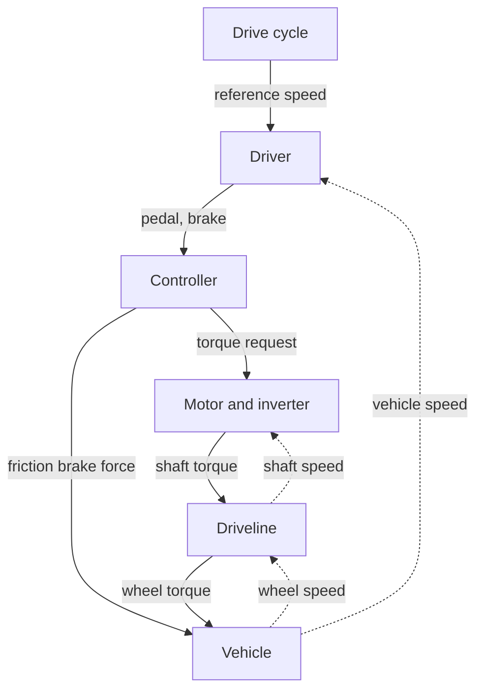
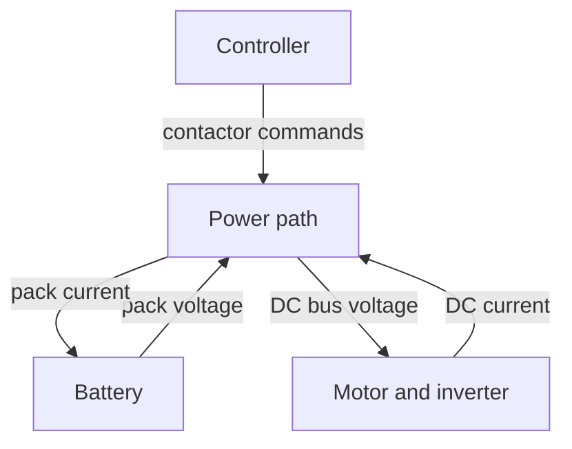
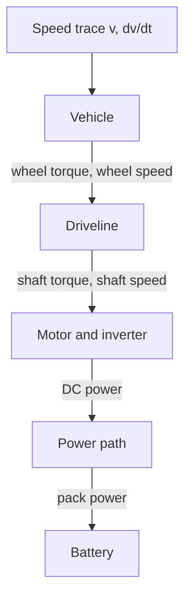

# Plant model reference framework

The plant is a chain of blocks that share one contract and one parameter set. It runs backward-facing for fast sizing sweeps and forward-facing for limits and co-simulation. This file is tool-neutral. Scilab Xcos and OpenModelica both build the blocks, and FMI is the boundary between them and the embedded code ([DEC-014](../../docs/decisions/DEC-014-plant-model-in-xcos.md), proposed). This is a reference, not an implementation. Every parameter value is TBD unless research sets a first-pass value.

## Contents

- [Power flow](#power-flow)
- [Modeling modes](#modeling-modes)
- [Blocks](#blocks)
- [Core equations](#core-equations)
- [Equations by block](#equations-by-block)
- [Sizing outputs](#sizing-outputs)
- [Block contract](#block-contract)
- [Tool mapping](#tool-mapping)
- [Co-simulation boundary](#co-simulation-boundary)
- [Run loops](#run-loops)
- [Build tools](#build-tools)

## Power flow

Power flows from the battery to the road while motoring, and back to the battery during regen. Speed and voltage flow the other way as feedback. The flow is shown in two diagrams that meet at the motor and inverter. In both, solid arrows carry power and commands, and dashed arrows carry feedback.

Command and mechanical chain:



Electrical chain:



Every block also sends its power loss to the optional Thermal block, which returns temperature.

Power at each interface, and the loss taken at each step:

| Interface | Power | Loss taken here |
| --- | --- | --- |
| Battery cells to pack terminals | $P_{pack} = V_{pack} I_{pack}$ | Cell resistance and RC losses, [Battery](#battery) |
| Pack terminals to DC bus | $V_{bus} I_{pack}$ | Wire, fuse, and contactor resistance, [Power path](#power-path) |
| DC bus to motor shaft | $P_{dc} \rightarrow P_{mech} = T_m \omega_m$ | Motor and inverter losses, [Motor and inverter](#motor-and-inverter) |
| Motor shaft to wheel | $T_w \omega_w$ | Chain or belt losses, [Driveline](#driveline) |
| Wheel to road | $F_{wheel} v$ | Drag, rolling, grade, and friction braking, [Vehicle](#vehicle) |

Sign convention:

- Power, torque, and current are positive in the motoring direction, from battery to road.
- Regen makes $T_m$, $P_{dc}$, and $I_{pack}$ negative. Losses stay positive in both directions, so regen returns less than the wheel gives up.
- Vehicle speed $v$ is zero or positive. The model does not drive in reverse.
- Auxiliary loads, such as the VCU and telemetry, draw from the DC bus as $P_{aux}$.

## Modeling modes

The plant supports both modes. They share one parameter set and one set of loss equations, so they cannot disagree on physics.

| | Backward-facing | Forward-facing |
| --- | --- | --- |
| Input | Speed trace $v(t)$ from the drive cycle | Reference speed, tracked by the driver model |
| Direction | Demand flows from the vehicle back to the battery | Commands flow from the driver to the wheels; states integrate forward |
| States | SOC, RC voltage, and temperature only | All states, including $v$ |
| Limits | Not enforced. Every sample where the demand exceeds a limit is flagged. | Enforced by the controller, so the kart falls behind the trace |
| Speed | Fast; one pass per cycle | Slower; solver steps through the dynamics |
| Use | Sizing sweeps over parameters such as $C_dA$, $C_{rr}$, $N$, and pack size | Limit checks, top speed, drivability, and co-simulation |
| Corpus example | Istardi 2009: kart lap speed trace to torque and energy | Adegbohun 2021, Thapa 2024, Tofrowaih 2025: PID driver tracking a cycle |

Rules:

- Forward-facing is the reference. Co-simulation uses only forward mode.
- Use backward mode to narrow a sweep. Confirm the chosen point in forward mode.
- A forward run that tracks the trace must match the backward energy per cycle within a tolerance. The tolerance is TBD.
- Backward mode reports the shortfall, not a clipped result. A flagged sample means the parameter set fails that cycle.

Backward demand flows from the speed trace down to the battery:



## Blocks

| Block | Sizing fidelity | Co-simulation fidelity | Owner |
| --- | --- | --- | --- |
| Drive cycle and driver | Speed trace per scenario ([DEC-011](../../docs/decisions/DEC-011-useful-session-definition.md)). Forward mode adds a PI driver producing pedal and brake. | Same, plus scripted fault events | System |
| Controller | Pedal to torque request, clipped to motor, battery current, and power limits. Splits braking between regen and friction. | Replaced by compiled embedded code | VCU |
| Motor and inverter | Torque-speed envelope with a loss model or efficiency map | Averaged dq-axis model, or brushed DC model, with current limits | DRV |
| Driveline | Fixed ratio and efficiency | Add backlash and compliance | DRV |
| Vehicle | Longitudinal force balance with rotating mass and friction brake | Add tire slip | CHS |
| Battery | Internal-resistance cell model, scaled by series and parallel count | 1 or 2 RC equivalent circuit per cell group, with cell spread | PACK |
| Power path | Lumped wire and fuse resistance, plus auxiliary load | Contactors, precharge, DC-link capacitance, fuse, E-stop | PACK |
| Thermal | Not needed | Lumped thermal mass per component, used for derating | TMS |

The friction brake moved to sizing fidelity. A forward run cannot follow a cycle's decelerations on regen alone.

## Core equations

| Block | Relations | Details |
| --- | --- | --- |
| Driver | $e = v_{ref} - v$, $u = K_p e + K_i \int e \, dt$ | [Drive cycle and driver](#drive-cycle-and-driver) |
| Controller | $T_{req} = a \, T_{max}(\omega_m, V_{bus})$, clipped by current and power limits | [Controller](#controller) |
| Motor, loss model | $P_{dc} = T_m \omega_m + k_c T_m^2 + k_i \omega_m + k_w \omega_m^3 + C$ | [Motor and inverter](#motor-and-inverter) |
| Motor, brushed DC | $d \, V_{bus} = R_a i_a + L_a \dot{i}_a + k_e \omega_m$, $T_m = k_t i_a$ | [Motor and inverter](#motor-and-inverter) |
| Motor, dq | $T_m = \tfrac{3}{2} p \left( \lambda i_q + (L_d - L_q) i_d i_q \right)$ | [Motor and inverter](#motor-and-inverter) |
| Driveline | $\omega_m = N \omega_w$, $T_w = N \eta_d T_m$ while motoring | [Driveline](#driveline) |
| Vehicle | $k_m m \dot{v} = F_{wheel} - F_{brake} - \tfrac{1}{2} \rho C_dA v^2 - C_{rr} m g \cos\theta - m g \sin\theta$ | [Vehicle](#vehicle) |
| Battery | $V_{pack} = n_s \left( \mathrm{OCV}(SOC) - R_0 I_{cell} - V_{rc} \right)$, $d \, SOC / dt = -I_{cell} / Q$ | [Battery](#battery) |
| Power path | $V_{bus} = V_{pack} - R_{path} I_{pack}$ | [Power path](#power-path) |
| Thermal | $C_{th} \dot{T} = P_{loss} - (T - T_{amb}) / R_{th}$ | [Thermal](#thermal) |

## Equations by block

Each section lists its symbols. The Parameter column is the name used in `params/` files. Vehicle values come from [vehicle-dynamics-constants.md](../../research/Vehicle%20Dynamics/vehicle-dynamics-constants.md#parameter-map).

### Drive cycle and driver

The cycle gives a reference speed. In forward mode, a PI driver turns speed error into pedal or brake (Adegbohun 2021, Thapa 2024).

$$e = v_{ref} - v$$

$$u = K_p \, e + K_i \int_0^t e \, d\tau$$

$$a = \min\left(\max(u, 0), 1\right), \qquad b = \min\left(\max(-u, 0), 1\right)$$

| Symbol | Parameter | Meaning | Unit | Value |
| --- | --- | --- | --- | --- |
| $v_{ref}$ | | Reference speed from the drive cycle | m/s | Per scenario, [DEC-011](../../docs/decisions/DEC-011-useful-session-definition.md) |
| $e$ | | Speed error | m/s | Computed |
| $u$ | | Driver command, positive to accelerate | 1 | Computed |
| $K_p$ | `K_p` | Proportional gain | s/m | TBD |
| $K_i$ | `K_i` | Integral gain | 1/m | TBD |
| $a$ | | Accelerator pedal position | 0 to 1 | Computed |
| $b$ | | Brake pedal position | 0 to 1 | Computed |

### Controller

The controller turns pedal into a torque request, then clips it to every limit. In co-simulation, compiled VCU code replaces this block.

$$T_{req} = a \, T_{max}(\omega_m, V_{bus})$$

$$T_{min}(\omega_m) \le T_m \le T_{max}(\omega_m, V_{bus})$$

$$I_{pack} \le I_{max}, \qquad P_{pack} \le P_{max}$$

Braking demand is split, regen first (Adegbohun 2021):

$$F_{dem} = b \, F_{b,max}$$

$$F_{regen} = \begin{cases} \min\left(F_{dem}, \; N \left| T_{min} \right| / r_w\right) & v > v_{regen} \\ 0 & v \le v_{regen} \end{cases}$$

$$F_{brake} = F_{dem} - F_{regen}$$

The regen share sets a negative $T_m$. This split ignores driveline efficiency, which is acceptable at sizing fidelity.

| Symbol | Parameter | Meaning | Unit | Value |
| --- | --- | --- | --- | --- |
| $T_{req}$ | | Torque request | N·m | Computed |
| $T_{max}$ | `T_max` | Motoring torque envelope, a function of shaft speed and bus voltage | N·m | TBD, motor choice |
| $T_{min}$ | `T_min` | Regen torque envelope, zero or negative | N·m | TBD, motor choice |
| $I_{max}$ | `I_max` | Pack discharge current limit | A | TBD, pack choice |
| $P_{max}$ | `P_max` | Pack power limit | W | TBD |
| $F_{dem}$ | | Total braking force demanded | N | Computed |
| $F_{b,max}$ | `F_b_max` | Braking force at full brake pedal | N | TBD |
| $F_{regen}$ | | Braking force taken by regen | N | Computed |
| $F_{brake}$ | | Friction braking force | N | Computed |
| $v_{regen}$ | `v_regen` | Speed below which regen is off | m/s | TBD |

### Motor and inverter

Sizing uses a loss model, which gives losses in both motoring and regen (Adegbohun 2021). The motor and inverter are lumped.

$$P_{mech} = T_m \, \omega_m$$

$$P_{loss} = k_c T_m^2 + k_i \, \omega_m + k_w \, \omega_m^3 + C$$

$$P_{dc} = P_{mech} + P_{loss}, \qquad I_{dc} = P_{dc} / V_{bus}$$

An efficiency map may replace the loss model when a datasheet gives one:

$$P_{dc} = \begin{cases} P_{mech} / \eta_m(T_m, \omega_m) & T_m \ge 0 \\ P_{mech} \, \eta_m(T_m, \omega_m) & T_m < 0 \end{cases}$$

A brushed DC motor with a chopper controller uses the armature model. Sizing sets $L_a$ to 0.

$$d \, V_{bus} = R_a i_a + L_a \frac{di_a}{dt} + k_e \, \omega_m, \qquad T_m = k_t \, i_a, \qquad I_{dc} = d \, i_a$$

A permanent-magnet AC motor in co-simulation uses the averaged dq-axis model, with $\omega_e = p \, \omega_m$:

$$v_d = R i_d + L_d \frac{di_d}{dt} - \omega_e L_q i_q$$

$$v_q = R i_q + L_q \frac{di_q}{dt} + \omega_e \left( L_d i_d + \lambda \right)$$

$$T_m = \tfrac{3}{2} p \left( \lambda i_q + (L_d - L_q) i_d i_q \right)$$

| Symbol | Parameter | Meaning | Unit | Value |
| --- | --- | --- | --- | --- |
| $T_m$ | | Shaft torque, negative in regen | N·m | Computed |
| $\omega_m$ | | Shaft speed | rad/s | Computed |
| $P_{mech}$ | | Shaft power | W | Computed |
| $P_{loss}$ | | Motor and inverter loss | W | Computed |
| $P_{dc}$ | | DC input power | W | Computed |
| $I_{dc}$ | | DC input current | A | Computed |
| $k_c$ | `k_c` | Copper loss coefficient | W/(N·m)² | TBD |
| $k_i$ | `k_i` | Iron loss coefficient | W·s/rad | TBD |
| $k_w$ | `k_w` | Windage loss coefficient | W·s³/rad³ | TBD |
| $C$ | `C_loss` | Constant loss | W | TBD |
| $\eta_m$ | `eta_m` | Efficiency map, if used | 1 | TBD |
| $d$ | | Chopper duty cycle | 0 to 1 | Computed |
| $R_a$, $L_a$ | `R_a`, `L_a` | Armature resistance and inductance | Ω, H | TBD |
| $k_e$, $k_t$ | `k_e`, `k_t` | Back-EMF and torque constants | V·s/rad, N·m/A | TBD |
| $i_a$ | | Armature current | A | Computed |
| $R$, $L_d$, $L_q$ | `R_s`, `L_d`, `L_q` | Stator resistance and dq inductances | Ω, H | TBD |
| $\lambda$ | `lambda_pm` | Permanent-magnet flux linkage | Wb | TBD |
| $p$ | `p` | Pole pairs | 1 | TBD |
| $i_d$, $i_q$, $v_d$, $v_q$ | | dq currents and voltages | A, V | Computed |

### Driveline

A fixed ratio with one efficiency. The efficiency multiplies while motoring and divides during regen.

$$\omega_w = v / r_w, \qquad \omega_m = N \, \omega_w$$

$$T_w = \begin{cases} N \, \eta_d \, T_m & T_m \ge 0 \\ N \, T_m / \eta_d & T_m < 0 \end{cases}$$

$$F_{wheel} = T_w / r_w$$

| Symbol | Parameter | Meaning | Unit | Value |
| --- | --- | --- | --- | --- |
| $N$ | `N` | Gear ratio, motor to wheel | 1 | Sizing output |
| $\eta_d$ | `eta_d` | Chain or belt efficiency | 1 | TBD |
| $r_w$ | `r_wheel` | Rolling radius of the driven wheel | m | TBD |
| $\omega_w$ | | Wheel speed | rad/s | Computed |
| $T_w$ | | Wheel torque | N·m | Computed |
| $F_{wheel}$ | | Tractive force at the road | N | Computed |

### Vehicle

A longitudinal force balance. The rotating-mass factor scales mass in the acceleration term only (Thapa 2024, Adegbohun 2021).

$$k_m \, m \frac{dv}{dt} = F_{wheel} - F_{brake} - F_{aero} - F_{roll} - F_{grade}$$

$$F_{aero} = \tfrac{1}{2} \rho \, C_dA \, v^2$$

$$F_{roll} = C_{rr} \, m \, g \cos\theta \cdot \operatorname{sgn}(v)$$

$$F_{grade} = m \, g \sin\theta$$

$$k_m = 1 + \frac{J_{total}}{m \, r_w^2}, \qquad J_{total} = J_{wheel} + N^2 J_{rotor}$$

Rolling and friction-brake forces vanish at standstill, so the kart never rolls backward (Tofrowaih 2025). Implementations replace $\operatorname{sgn}(v)$ with a smooth step, such as $\tanh(v / v_\epsilon)$, so the solver does not chatter. Sizing may set $k_m$ directly until $J_{total}$ is known.

| Symbol | Parameter | Meaning | Unit | Value |
| --- | --- | --- | --- | --- |
| $v$ | | Vehicle speed, the state | m/s | Computed |
| $m$ | `m` | Total mass, driver plus kart | kg | [Parameter map](../../research/Vehicle%20Dynamics/vehicle-dynamics-constants.md#parameter-map) |
| $k_m$ | `k_m` | Rotating-mass factor | 1 | [Parameter map](../../research/Vehicle%20Dynamics/vehicle-dynamics-constants.md#parameter-map) |
| $\rho$ | `rho` | Air density | kg/m³ | [Parameter map](../../research/Vehicle%20Dynamics/vehicle-dynamics-constants.md#parameter-map) |
| $C_dA$ | `CdA` | Drag area, drag coefficient times frontal area | m² | [Parameter map](../../research/Vehicle%20Dynamics/vehicle-dynamics-constants.md#parameter-map) |
| $C_{rr}$ | `Crr` | Rolling resistance coefficient | 1 | [Parameter map](../../research/Vehicle%20Dynamics/vehicle-dynamics-constants.md#parameter-map) |
| $g$ | `g` | Gravitational acceleration | m/s² | [Parameter map](../../research/Vehicle%20Dynamics/vehicle-dynamics-constants.md#parameter-map) |
| $\theta$ | `theta` | Road grade angle | rad | [Parameter map](../../research/Vehicle%20Dynamics/vehicle-dynamics-constants.md#parameter-map) |
| $J_{total}$ | `J_total` | Rotating inertia referred to the wheel | kg·m² | TBD |
| $J_{wheel}$ | `J_wheel` | Wheels, axle, and wheel-side sprocket | kg·m² | TBD |
| $J_{rotor}$ | `J_rotor` | Rotor and motor-side sprocket | kg·m² | TBD |
| $v_\epsilon$ | `v_eps` | Smoothing speed for the standstill step | m/s | TBD |
| $F_{wheel}$, $F_{brake}$ | | From the driveline and controller | N | Computed |

### Battery

Cells scale to the pack by series and parallel count. Sizing drops the RC branch ($V_{rc} = 0$).

$$I_{cell} = I_{pack} / n_p$$

$$V_{pack} = n_s \left( \mathrm{OCV}(SOC) - R_0 I_{cell} - V_{rc} \right)$$

$$\frac{dV_{rc}}{dt} = \frac{I_{cell}}{C_1} - \frac{V_{rc}}{R_1 C_1}$$

$$\frac{d \, SOC}{dt} = -\frac{I_{cell}}{Q}$$

Backward mode knows the power and solves for current (Adegbohun 2021):

$$I_{pack} = \frac{V_{oc} - \sqrt{V_{oc}^2 - 4 R_{pack} P_{pack}}}{2 R_{pack}}, \qquad V_{oc} = n_s \, \mathrm{OCV}(SOC), \qquad R_{pack} = \frac{n_s R_0}{n_p}$$

A negative discriminant means the pack cannot deliver that power. Backward mode flags the sample.

| Symbol | Parameter | Meaning | Unit | Value |
| --- | --- | --- | --- | --- |
| $n_s$, $n_p$ | `n_s`, `n_p` | Cells in series and in parallel | 1 | Sizing output |
| $\mathrm{OCV}(SOC)$ | `OCV_table` | Cell open-circuit voltage curve | V | TBD, cell choice |
| $R_0$ | `R_0` | Cell series resistance | Ω | TBD, cell choice |
| $R_1$, $C_1$ | `R_1`, `C_1` | Cell RC pair | Ω, F | TBD, cell choice |
| $Q$ | `Q_cell` | Cell capacity | A·s | TBD, cell choice |
| $SOC$ | | State of charge, a state | 0 to 1 | Computed |
| $V_{rc}$ | | RC branch voltage, a state | V | Computed |
| $I_{pack}$, $I_{cell}$ | | Pack and cell current | A | Computed |
| $V_{pack}$ | | Pack terminal voltage | V | Computed |
| $P_{pack}$ | | Pack terminal power | W | Computed |

### Power path

The pack feeds the DC bus through lumped resistance. The bus supplies the motor and auxiliary loads.

$$V_{bus} = V_{pack} - R_{path} I_{pack}$$

$$V_{bus} I_{pack} = P_{dc} + P_{aux}$$

Co-simulation adds precharge and the fuse:

$$\frac{dV_{link}}{dt} = \frac{V_{pack} - V_{link}}{R_{pre} \, C_{link}}$$

$$\text{fuse trips when} \int I_{pack}^2 \, dt \ge \left( I^2 t \right)_{fuse}$$

| Symbol | Parameter | Meaning | Unit | Value |
| --- | --- | --- | --- | --- |
| $V_{bus}$ | | DC bus voltage at the inverter | V | Computed |
| $R_{path}$ | `R_path` | Wire, fuse, and contactor resistance | Ω | TBD |
| $P_{aux}$ | `P_aux` | Auxiliary electronics load | W | TBD |
| $V_{link}$ | | DC-link capacitor voltage, a state | V | Computed |
| $R_{pre}$ | `R_pre` | Precharge resistance | Ω | TBD |
| $C_{link}$ | `C_link` | DC-link capacitance | F | TBD |
| $(I^2t)_{fuse}$ | `I2t_fuse` | Fuse let-through rating | A²·s | TBD |

### Thermal

One lumped node per component, used for derating in co-simulation.

$$C_{th} \frac{dT}{dt} = P_{loss} - \frac{T - T_{amb}}{R_{th}}$$

| Symbol | Parameter | Meaning | Unit | Value |
| --- | --- | --- | --- | --- |
| $T$ | | Component temperature, a state | K | Computed |
| $C_{th}$ | `C_th` | Thermal capacity | J/K | TBD |
| $R_{th}$ | `R_th` | Thermal resistance to ambient | K/W | TBD |
| $T_{amb}$ | `T_amb` | Ambient temperature | K | TBD |
| $P_{loss}$ | | Loss from the component's block | W | Computed |

## Sizing outputs

Each output checks against a REQ in [GOALS.md](../../docs/project/GOALS.md#system-requirements).

| Output | Definition | Mode | Checks |
| --- | --- | --- | --- |
| Top speed | Steady $v$ at full pedal on level ground | Forward | REQ-SYS-001 |
| Energy per cycle | $E_{cycle} = \int_0^{t_{cycle}} V_{pack} I_{pack} \, dt$ | Both | REQ-SYS-002, REQ-SYS-004 |
| Regen recovered | The negative part of $E_{cycle}$ | Both | REQ-SYS-004 |
| Run time | Time until SOC or cell voltage reaches its floor, repeating the cycle | Both | REQ-SYS-002 |
| Peak and continuous power | Peak and sustained $P_{pack}$; the continuous window is TBD | Both | REQ-SYS-004 |
| Peak torque and gear ratio range | $T_m$ and $N$ that meet every cycle without a flag | Backward sweep, forward check | REQ-SYS-001, REQ-SYS-004 |
| Pack voltage and current | $V_{pack}$ range and peak $I_{pack}$ | Both | REQ-SAF-002 at full charge |
| Design load | All outputs computed at the REQ-SYS-003 mass | Both | REQ-SYS-003 |

## Block contract

Every block follows one contract, whichever tool builds it. The forward part mirrors an FMI component, so any block can later be exported as an FMU or wrapped as C code.

```text
block <Name>
  params                                   fixed values from params/
  state                                    integrated quantities, such as v, SOC, V_rc, T
  inputs                                   signals from neighbors or actuators
  outputs                                  signals to neighbors or sensors
  init(params)                -> state
  derivatives(t, state, in)   -> d(state)/dt
  outputs(t, state, in)       -> out
  events(t, state, in)        -> discrete changes, such as contactor open or fuse trip
  inverse(t, state, demand)   -> upstream demand, limit flags   backward mode only
```

- `inverse` uses the same equations and params as the forward part. It must not carry its own copy of a loss model.
- In backward mode only the Battery and Thermal blocks integrate state.
- The Driver and Controller have no `inverse`. Backward mode bypasses them.

Forward signals, in SI units:

| From | To | Signals |
| --- | --- | --- |
| Drive cycle | Driver | Reference speed |
| Driver | Controller | Pedal position, brake position |
| Controller | Motor and inverter | Torque request, enable |
| Controller | Vehicle | Friction brake force |
| Controller | Power path | Contactor and precharge commands |
| Battery | Power path | Pack voltage |
| Power path | Battery | Pack current |
| Power path | Motor and inverter | DC bus voltage |
| Motor and inverter | Power path | DC current |
| Motor and inverter | Driveline | Shaft torque |
| Driveline | Motor and inverter | Shaft speed |
| Driveline | Vehicle | Wheel torque |
| Vehicle | Driveline, Driver | Wheel speed, vehicle speed |
| Every block | Thermal | Power loss |
| Thermal | Every block | Temperature |

Backward demands:

| From | To | Demand |
| --- | --- | --- |
| Drive cycle | Vehicle | Speed and acceleration |
| Vehicle | Driveline | Wheel torque and wheel speed |
| Driveline | Motor and inverter | Shaft torque and shaft speed |
| Motor and inverter | Power path | DC power |
| Power path | Battery | Pack power |
| Every block | Run report | Limit flags |

## Tool mapping

Each tool realizes the contract in its own terms. The mapping is the same for every block.

| Contract element | Scilab Xcos | OpenModelica |
| --- | --- | --- |
| params | Block parameters and diagram context, values from `params/` | Model parameters, values from `params/` |
| state | Continuous states of the blocks inside a superblock | Continuous states of the model's equations |
| inputs and outputs | Superblock ports | Connectors and input or output declarations |
| events | Event and zero-crossing blocks | `when` equations and events |
| inverse | A separate inverse superblock per block, because Xcos is causal | Often free: prescribe speed with a speed source, and the acausal equations solve for torque. Table lookups still need an explicit inverse. |
| Physics | Block equations per block | Equations, often acausal, with the Modelica Standard Library |
| Co-simulation export | FMI export of the top-level forward diagram | FMI export of the forward model |

Source files live in `xcos/` or `modelica/`. Which tool builds which block is open item 2 in [README.md](README.md).

## Co-simulation boundary

Co-simulation runs forward mode only. The plant exposes only what real hardware exposes: sensor outputs and actuator inputs.

| Embedded code | Plant gives it | Plant takes from it |
| --- | --- | --- |
| VCU | Pedal, brake, wheel speed, pack and motor status messages | Torque request, friction brake command if actuated, drive enable |
| BMS | Cell voltages, pack current, temperatures, contactor feedback | Contactor, precharge, and balancing commands |
| Motor control | Phase currents or armature current, DC bus voltage, rotor angle or Hall states | Phase voltage or duty commands |

- The compiled VCU replaces the Controller block, including its limits and brake split. The Driver stays in the plant.
- Messages between nodes follow the DBC once it exists (REQ-SYS-005).
- Embedded code builds for the host as a shared library, with a hardware abstraction stub replacing drivers.
- The library exposes a small C interface: `init`, `step(t, sensors) -> actuators`, and `terminate`.
- How the plant calls that library, by direct link or by a wrapper FMU, is open item 4 in [README.md](README.md).

## Run loops

Tool-neutral:

```text
backward(params, cycle):
  for each sample of the speed trace:
    vehicle, driveline, motor, power path, battery: inverse, in that order
    integrate SOC and RC voltage; record limit flags
  report sizing outputs and every flagged sample

sweep(param_grid, cycle):
  for each param set: backward(params, cycle)
  keep the sets with no flags; confirm the chosen set with standalone()

standalone(params, cycle):
  load the forward plant from xcos/ or modelica/ with params and cycle
  simulate over the cycle time span with the tool's solver
  report sizing outputs against the REQs in GOALS.md
  compare energy per cycle with backward(params, cycle)

cosim(params, cycle, controller_lib):
  load the forward plant with controller_lib wired to its boundary
  controller_lib.init()
  every controller tick (fixed step, the code's task rate):
    sensors   = plant outputs at the boundary
    actuators = controller_lib.step(t, sensors)
    advance plant to the next tick with fixed substeps, actuators held
  log signals; check faults and limits
```

## Build tools

Scilab Xcos and OpenModelica are the candidate tools ([DEC-014](../../docs/decisions/DEC-014-plant-model-in-xcos.md), proposed). Both must export FMI co-simulation units. Version, FMI export and import, and FMU loading on macOS are open item 3 in [README.md](README.md).
